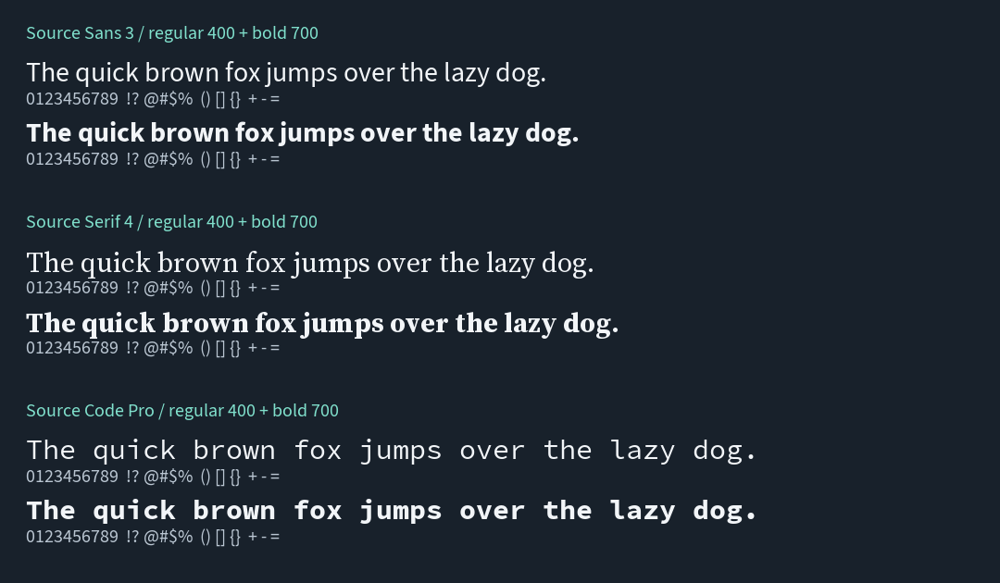

# Font samples

Three Adobe Source families across **sans-serif, serif and monospace**, each
in **regular (400)** and **bold (700)**. Four formats provide **24 font files**,
4,742,560 bytes total (4.52 MiB). Every font file is below 450 KB.

[Repository usage](../README.md) | [Licensing and provenance](RIGHTS.md)



The preview uses the TTF fixtures. Download the actual fonts below for testing.

## Formats

| Format | Contents | Files |
| --- | --- | ---: |
| [TTF](ttf/README.md) | TrueType outlines | 6 |
| [OTF](otf/README.md) | CFF outlines | 6 |
| [WOFF](woff/README.md) | Compressed OpenType with CFF outlines | 6 |
| [WOFF2](woff2/README.md) | Brotli-compressed OpenType with CFF outlines | 6 |

## Families

| Category | Family | Styles |
| --- | --- | --- |
| Sans-serif | Source Sans 3 | Regular, Bold |
| Serif | Source Serif 4 | Regular, Bold |
| Monospace | Source Code Pro | Regular, Bold |

These are static fonts, not variable fonts. All faces are upright. The official
upstream files are preserved without subsetting or format conversion. TTF uses
TrueType outlines; OTF and the selected webfont builds use CFF outlines. These
variants represent the same family and style but may rasterize differently.

The selection supports font-loading and text-rendering smoke tests. It does
not cover every script, glyph, font technology or malformed-input case.

## Filenames and use

```text
fonts/<format>/<category>/<family>-<style>.<extension>
```

For example, `woff2/monospace/source-code-pro-bold.woff2` is Source Code Pro
Bold, with a CSS weight of 700. Regular faces have weight 400.

Clone or download files for offline use. No system-wide font installation is
required for an application that loads font files directly. For web use, serve
the files from your site and reference them with `@font-face`. Cross-origin
hosting must provide appropriate CORS headers; a GitHub raw download URL is
not a general-purpose font CDN.

```css
@font-face {
  font-family: "Fixture Sans";
  src: url("./fonts/woff2/sans-serif/source-sans-3-regular.woff2")
    format("woff2");
  font-style: normal;
  font-weight: 400;
  font-display: swap;
}
```

## Rights

Fonts are licensed under **SIL OFL-1.1**, with Adobe copyright and reserved
font name notices retained. They are not public-domain or CC0 fixtures. Each
family has its original license in `LICENSES/`; [font rights](RIGHTS.md) links
every binary to a pinned upstream source and records its SHA-256 checksum.
Include the matching license and copyright notice when redistributing.
