# Image gallery

15 subjects across 7 categories. Every subject is available in PNG,
JPEG, GIF, BMP, WebP and AVIF at longest-edge sizes of 64, 128, 256,
512 and 1024 pixels.

[Usage](../README.md) | [Credits and rights](RIGHTS.md)

Formats: [PNG](png/README.md) | [JPEG](jpg/README.md) | [GIF](gif/README.md) | [BMP](bmp/README.md) | [WebP](webp/README.md) | [AVIF](avif/README.md)

## Nature

### Mountain lake

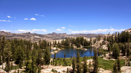

[Source and rights](RIGHTS.md#mountain-lake)

### Green landscape

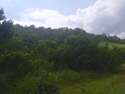

[Source and rights](RIGHTS.md#green-landscape)

## People

### Grace Hopper

[Source and rights](RIGHTS.md#grace-hopper)

### Katherine Johnson

[Source and rights](RIGHTS.md#katherine-johnson)

## Objects

### Fuji apples

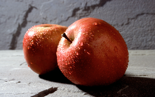

[Source and rights](RIGHTS.md#fuji-apples)

### Hot peppers

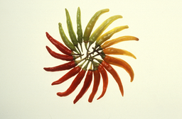

[Source and rights](RIGHTS.md#hot-peppers)

## Animals

### Cat on a couch

[Source and rights](RIGHTS.md#cat-on-couch)

### Dog portrait

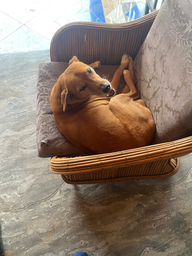

[Source and rights](RIGHTS.md#dog-portrait)

## Space

### The Blue Marble

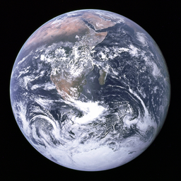

[Source and rights](RIGHTS.md#blue-marble)

### Full Moon from the ISS

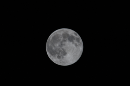

[Source and rights](RIGHTS.md#full-moon)

### Orbital station and escort

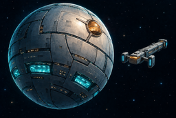

[Source and rights](RIGHTS.md#orbital-station)

## Illustrations

### The Great Wave off Kanagawa

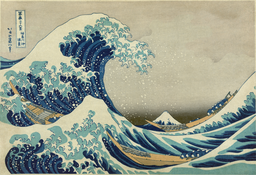

[Source and rights](RIGHTS.md#great-wave)

### Mona Lisa

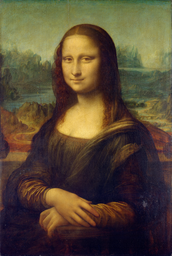

[Source and rights](RIGHTS.md#mona-lisa)

## Patterns

### Colour chart

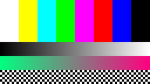

[Source and rights](RIGHTS.md#colour-chart)

### Transparent shapes

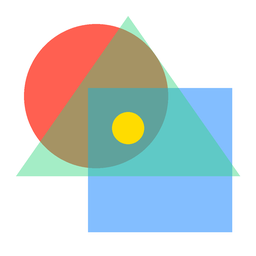

[Source and rights](RIGHTS.md#transparent-shapes)
