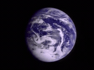
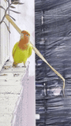
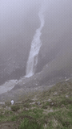
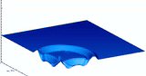
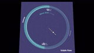

# Video gallery

Five subjects across animals, nature, space and patterns. Each subject uses the
same short excerpt in six video containers and animated GIF. Filenames state the
actual **width x height in pixels**, followed by `landscape` or `portrait`.

Bird videos include **720 x 1280 portrait** frames. Moon-orbit videos include
**1280 x 720 landscape** frames. Both use native HD sources without upscaling;
all subjects also have smaller variants listed below.

There are **98 video/animation files**, 15,481,128 bytes in total
(14.76 MiB), plus six small subtitle sidecars.
The largest file is 1,944,690 bytes; every fixture stays below 2 MB.

[Repository usage](../README.md) | [Credits and rights](RIGHTS.md)

## Formats and codecs

Extensions name containers, which can hold different codecs. These fixtures use:

| Format | Video codec | Frame rate | Files |
| --- | --- | ---: | ---: |
| [MP4](mp4/README.md) | H.264 / AVC | 15 fps | 15 |
| [WebM](webm/README.md) | VP9 | 15 fps | 15 |
| [MOV](mov/README.md) | H.264 / AVC | 15 fps | 15 |
| [MKV](mkv/README.md) | H.264 / AVC | 15 fps | 15 |
| [AVI](avi/README.md) | Motion JPEG | 15 fps | 14 |
| [OGV](ogv/README.md) | Theora | 15 fps | 14 |
| [Animated GIF](gif/README.md) | 128-colour palette | 5 fps | 10 |

The original 82 variants are **three seconds and silent**, with no subtitles.
Sixteen additional [audio and subtitle examples](TRACKS.md) use Moon orbit
with added piano or frequency-sweep soundtracks and selectable text tracks.
Their nominal duration is three seconds; codec padding can extend timestamps.
Each size keeps the source framing and aspect ratio, subject to rounding the
shorter edge to an even pixel count. MP4, MOV and MKV contain the same encoded
H.264 frames. Other formats are lossy encodes of the same normalized frames.

GIF delays use centiseconds. Theora can hold an unchanged image rather than
emit a new decoded frame for every presentation tick. Use timestamps and duration
when testing playback rather than assuming every format exposes 45 packets.
These are compact smoke-test/demo fixtures, not a comprehensive codec suite.

## Audio and subtitles

Each of the six video containers includes a **one-audio-track** example and a
**two-audio-track** example. MP4, MOV, MKV and WebM also include embedded
English and Spanish subtitles; MKV adds an English styled ASS track.
Separate **SRT, WebVTT and ASS** files provide the same two caption cues.
These captions describe the scene and added soundtracks; they are not dialogue.

See the [track guide and downloads](TRACKS.md) for codec mappings, track
order, language tags, default-selection differences and subtitle sidecars.

## Resolutions

Dimensions are always **width x height**, with orientation shown explicitly.
Each listed resolution is available in all six video containers. Animated GIFs
use only the two small resolutions per subject.

| Subject | Small frames (width x height) | HD frame (MP4 download) | Orientation |
| --- | --- | --- | --- |
| Earth rotation | 160 x 120, 320 x 240 | Not available | Landscape |
| Bird on a ledge | 90 x 160, 180 x 320 | [720 x 1280](mp4/animals/bird-on-ledge-720x1280-portrait.mp4) | Portrait |
| Misty waterfall | 90 x 160, 180 x 320 | Not available | Portrait |
| Shallow-water waves | 160 x 84, 320 x 168 | Not available | Landscape |
| Moon orbit | 160 x 90, 320 x 180 | [1280 x 720](mp4/space/moon-orbit-1280x720-landscape.mp4) | Landscape |

The HD fixtures are 1280 x 720 landscape (720p) and 720 x 1280 portrait.
Filenames always state width before height. Lower-resolution sources are not
upscaled.

## Clips

The embedded previews below use each subject's smallest animated GIF fixture.
Open a format link for exact frame dimensions, orientations and downloads.
Playback support depends on your player.

### Earth rotation



[MP4](mp4/README.md#earth-rotation) | [WebM](webm/README.md#earth-rotation) | [MOV](mov/README.md#earth-rotation) | [MKV](mkv/README.md#earth-rotation) | [AVI](avi/README.md#earth-rotation) | [OGV](ogv/README.md#earth-rotation) | [Animated GIF](gif/README.md#earth-rotation)

[Source and rights](RIGHTS.md#earth-rotation)

### Bird on a ledge



[MP4](mp4/README.md#bird-on-ledge) | [WebM](webm/README.md#bird-on-ledge) | [MOV](mov/README.md#bird-on-ledge) | [MKV](mkv/README.md#bird-on-ledge) | [AVI](avi/README.md#bird-on-ledge) | [OGV](ogv/README.md#bird-on-ledge) | [Animated GIF](gif/README.md#bird-on-ledge)

[Source and rights](RIGHTS.md#bird-on-ledge)

### Misty waterfall



[MP4](mp4/README.md#misty-waterfall) | [WebM](webm/README.md#misty-waterfall) | [MOV](mov/README.md#misty-waterfall) | [MKV](mkv/README.md#misty-waterfall) | [AVI](avi/README.md#misty-waterfall) | [OGV](ogv/README.md#misty-waterfall) | [Animated GIF](gif/README.md#misty-waterfall)

[Source and rights](RIGHTS.md#misty-waterfall)

### Shallow-water waves



[MP4](mp4/README.md#shallow-water-waves) | [WebM](webm/README.md#shallow-water-waves) | [MOV](mov/README.md#shallow-water-waves) | [MKV](mkv/README.md#shallow-water-waves) | [AVI](avi/README.md#shallow-water-waves) | [OGV](ogv/README.md#shallow-water-waves) | [Animated GIF](gif/README.md#shallow-water-waves)

[Source and rights](RIGHTS.md#shallow-water-waves)


### Moon orbit



[MP4](mp4/README.md#moon-orbit) | [WebM](webm/README.md#moon-orbit) | [MOV](mov/README.md#moon-orbit) | [MKV](mkv/README.md#moon-orbit) | [AVI](avi/README.md#moon-orbit) | [OGV](ogv/README.md#moon-orbit) | [Animated GIF](gif/README.md#moon-orbit)

[Source and rights](RIGHTS.md#moon-orbit)

## Use a file

Naming: `videos/<format>/<category>/<subject>-<width>x<height>-<orientation>.<extension>`.

```text
videos/mp4/animals/bird-on-ledge-720x1280-portrait.mp4
videos/mp4/space/moon-orbit-1280x720-landscape.mp4
```

```text
https://raw.githubusercontent.com/thestonefox/media-fixtures/main/videos/mp4/animals/bird-on-ledge-720x1280-portrait.mp4
```

Replace `main` with a full commit SHA for a stable fixture URL. Download files
or clone the repository; no tools or dependencies are needed to use them.

## Size policy

Keep clips short and each fixture below 2 MB. Include HD only when source
resolution supports it; keep GIF previews small. This batch stays below
16 MB total and needs no Git LFS. Do not add upstream originals,
conversion tools or generated build output to the repository.
